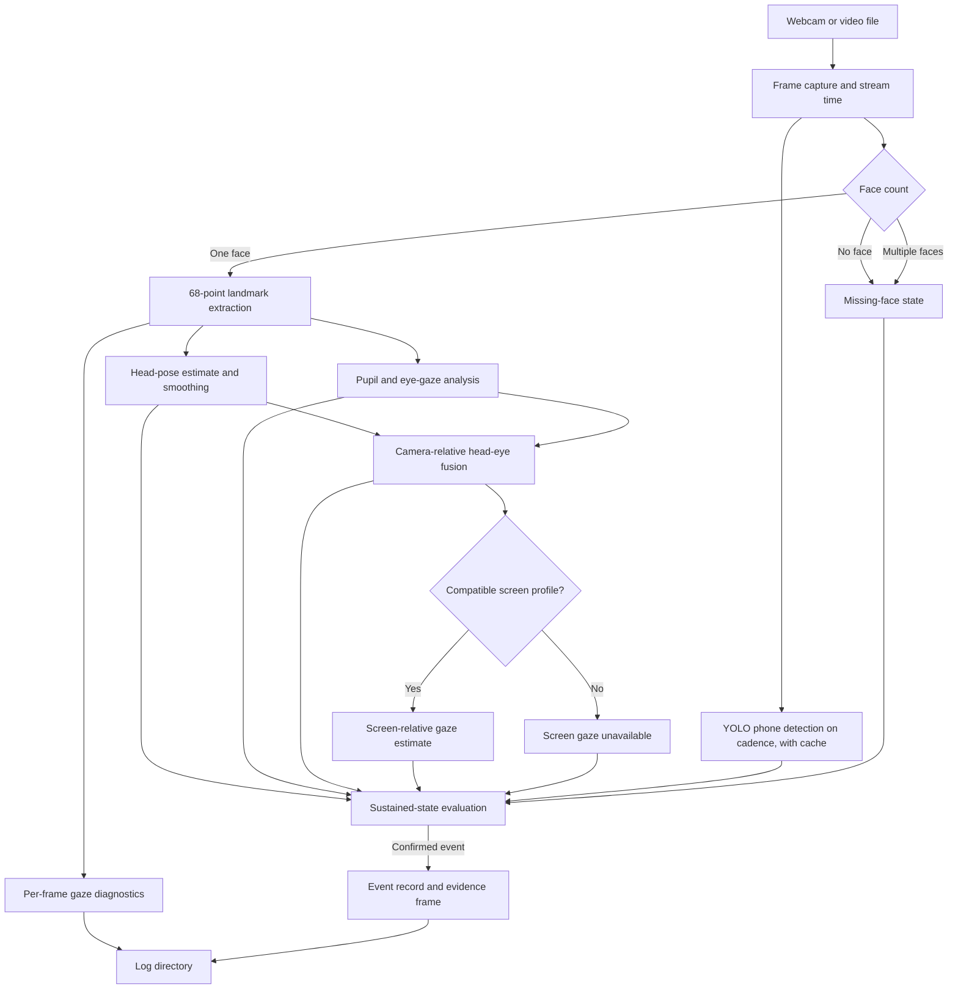

<div align="center">

# Cheating Surveillance System

### Signals, not verdicts.

A local computer-vision prototype for examining **head pose, eye gaze, screen-relative attention, face presence, and mobile-phone detections** from a webcam or recorded video.

The application combines independent visual signals, keeps uncertainty visible, and records sustained events for human review. It is a research and development prototype—not an automated misconduct decision system.

[](actions/workflows/ci.yml)
[](https://www.python.org/)
[](https://opencv.org/)
[](https://pytorch.org/)
[](https://pytest.org/)

**Local frame processing** · **Head + eye signals** · **Optional display calibration** · **Reviewable event evidence**

[Overview](#overview) · [Capabilities](#capabilities) · [Architecture](#architecture) · [Tech stack](#technology-stack) · [Setup](#setup) · [Run](#run) · [Evidence and privacy](#evidence-and-privacy) · [Testing](#testing) · [Limitations](#limitations-and-responsible-use)

</div>

---

## Overview

Cheating Surveillance System analyzes a webcam stream or a user-provided video on the local machine. A dlib face detector and 68-point facial landmark predictor feed separate head-pose and eye/pupil analysis paths. Their structured outputs are fused into a **camera-relative attention estimate**; an optional five-point workflow maps that estimate into **screen-relative gaze** for a compatible display setup.

A separate Ultralytics YOLO path checks for mobile phones on a configurable frame cadence. The runtime evaluates sustained states, writes structured event and gaze-diagnostic logs, and captures a frame when an incident is confirmed.

The project does not upload a video stream to a cloud proctoring service. Its offline controls target Ultralytics synchronization, update checks, telemetry, and automatic dependency installation. They are **not a host-wide network firewall** and do not prevent arbitrary application code from making network requests.

> [!IMPORTANT]
> A detected state is an algorithmic signal affected by camera placement, lighting, occlusion, calibration, and individual differences. It is not proof of cheating. Review events in context and keep consequential decisions with a qualified human reviewer.

## Capabilities

| Signal | What the implementation does |
|---|---|
| **Face and landmarks** | Detects face count and extracts 68-point landmarks for the selected face; missing-face and multiple-face states are handled separately. It does not identify a person. |
| **Head pose** | Estimates yaw, pitch, and roll from facial landmarks using OpenCV `solvePnP`, with temporal smoothing and independent head-direction states. |
| **Eye gaze** | Locates pupils within landmark-derived eye regions, normalizes per-eye measurements against a neutral baseline, and reports directional or uncertain states. |
| **Single-eye fallback** | Can continue with one eye when the other is unavailable, with reduced confidence and tracking-state reporting. |
| **Fused attention** | Combines head and eye vectors into a confidence-aware camera-relative gaze estimate. Raw head and eye observations remain available independently. |
| **Screen-relative gaze** | A separate five-point calibration fits a mapping from fused gaze to normalized display coordinates. It reports on-screen, near-boundary, outside-screen, uncertain, or calibration-required states. |
| **Mobile-phone detection** | Runs the local YOLO model at a configurable frame interval and uses a short-lived detection cache between inference frames. This is not a general prohibited-object detector. |
| **Sustained-state monitoring** | Applies duration thresholds before confirming supported events; the default violation threshold is 3 seconds. Brief uncertainty and event-specific safeguards are handled in the runtime. |
| **Event and gaze diagnostics** | Writes structured event records and per-frame numeric gaze diagnostics to the configured log directory. |
| **Evidence protection utilities** | Includes optional authenticated evidence encryption, audited export, path checks, and retention audit/purge utilities. Encryption is disabled by default. |

## Runtime flow



A screen profile is optional: head-pose, eye-gaze, and fused camera-relative monitoring do not depend on screen calibration. Screen-relative output is unavailable until a compatible calibration is loaded or completed.

## Architecture

| Module | Responsibility |
|---|---|
| `main.py` | CLI, camera/video lifecycle, startup calibration, HUD, sustained-event evaluation, evidence capture, and cleanup. |
| `vision_pipeline.py` | One face-detection and landmark pass per frame; coordinates head, eye, fusion, screen-gaze, and gaze diagnostics. |
| `head_pose.py` | Landmark-based pose estimation, directional classification, and temporal smoothing. |
| `eye_movement.py` | Eye crops, pupil localization, neutral gaze calibration, and eye-direction analysis. |
| `single_eye_fallback.py` | Confidence-aware paired-eye and single-eye tracking states. |
| `gaze_fusion.py` | Structured head/eye result validation and camera-relative vector fusion. |
| `screen_gaze.py` | Five-point calibration, display-geometry checks, screen mapping, profile persistence, and boundary classification. |
| `mobile_detection.py` | Integrity-checked YOLO loading, phone inference cadence, caching, and detection state. |
| `event_logger.py`, `telemetry.py`, `time_source.py` | CSV event records, local performance measurements, and live/video/mock time sources. |
| `model_integrity.py`, `network_isolation.py` | Model size/hash verification and Ultralytics-specific offline controls. |
| `crypto_core.py`, `keystore.py`, `encrypted_storage.py` | AES-GCM evidence envelopes and key-management primitives. |
| `evidence_export.py`, `evidence_retention.py`, `evidence_migration.py`, `path_security.py` | Audited export, retention inventory/purge, legacy evidence audit/backup checks, and safe-path checks. The migration CLI remains dry-run oriented. |
| `config.py` | Defaults, `.env` loading, path resolution, and startup validation. |

## Technology stack

The dependency manifest pins the principal packages below. The repository does not declare a formal supported Python-version matrix.

| Area | Package / implementation | Version in `requirements.txt` |
|---|---|---:|
| Runtime | Python | Not pinned |
| Frame processing | `opencv-python` | `4.11.0.86` |
| Numeric operations | `numpy` | `1.26.4` |
| Face landmarks | `dlib` | `19.24.6` |
| Model runtime | `torch` / `torchvision` | `2.2.2` / `0.17.2` |
| Phone detector | `ultralytics` | `8.3.82` |
| Authenticated encryption | `cryptography` | `>=42.0.0` |
| Tests | `pytest` | Not listed as a requirement |

> [!NOTE]
> The comments in `requirements.txt` describe a local Windows x64 / Python 3.13.5 environment with newer package versions than several exact pins in the same file (including NumPy, dlib, PyTorch, and Ultralytics). A clean install from the pins is not demonstrated by that note. Resolve and validate a compatible dependency set for your interpreter before relying on a fresh installation. The current codebase does not establish support for macOS or Linux; evidence key wrapping uses Windows DPAPI.

## Setup

Run these commands from the repository root in PowerShell:

```powershell
python -m venv .venv
.\.venv\Scripts\Activate.ps1
python -m pip install -r requirements.txt
Copy-Item .env.example .env
```

`.env` is optional; `config.py` loads it from the repository root without replacing variables already set in the process environment. Defaults are used when values are absent. Keep local secrets and real environment files out of version control. The manifest comments mention a pytest version, but `pytest` is not an installable requirement in `requirements.txt`; add it to a development environment if it is not already available.

### Model setup and integrity verification

The application requires two local pre-trained model files located in the `model/` directory (or configured through `SURVEILLANCE_MODEL_DIR`). Because model weight binaries are large (~118.6 MB combined) and governed by upstream terms, they are **excluded from Git tracking** via `.gitignore` and are not included in a fresh clone.

Before deserializing or invoking either model, `model_integrity.py` validates presence, verifies exact byte lengths, and computes streaming SHA-256 digests against the trusted registry below. Any missing, truncated, or hash-mismatched file triggers a fail-closed exception (`ModelMissingError` or `ModelCorruptedError`) before `torch.load` or `dlib.shape_predictor` executes:

| Required filename | Purpose | Expected size | Trusted SHA-256 |
|---|---|---:|---|
| `model/best_yolov12.pt` | Mobile-phone detector (YOLO) | 18,930,963 bytes | `c9edee36f87fb8d450c1608f9e2bd88a7c3f16e5351c1cbdc7079de5ff470d2a` |
| `model/shape_predictor_68_face_landmarks.dat` | dlib 68-point facial landmark predictor | 99,693,937 bytes | `fbdc2cb80eb9aa7a758672cbfdda32ba6300efe9b6e6c7a299ff7e736b11b92f` |

> [!CAUTION]
> **Model licensing and acquisition:** Obtain model assets only from sources for which you hold appropriate usage and redistribution rights. The canonical 68-point landmark predictor was trained on the iBUG 300-W dataset, which carries strict non-commercial research terms; YOLO/Ultralytics models have separate licensing terms (AGPL-3.0 or commercial). Verify terms and compliance independently before obtaining or deploying either asset. No unverified download links, mirrors, or redistribution permissions are provided by this repository.

### Effective configuration

| Variable | Default | Effect |
|---|---:|---|
| `SURVEILLANCE_CAMERA_INDEX` | `0` | Default webcam index. |
| `SURVEILLANCE_FRAME_WIDTH` / `SURVEILLANCE_FRAME_HEIGHT` | `640` / `480` | Requested capture size. |
| `SURVEILLANCE_CALIBRATION_DURATION_SEC` | `5.0` | Neutral head/eye baseline collection period. |
| `SURVEILLANCE_MIN_CALIBRATION_SAMPLES` / `SURVEILLANCE_MIN_GAZE_CALIBRATION_SAMPLES` | `10` / `10` | Minimum head and gaze baseline samples. |
| `SURVEILLANCE_VIOLATION_THRESHOLD_SEC` | `3.0` | Sustained-state confirmation threshold. |
| `SURVEILLANCE_PHONE_CONFIDENCE_THRESHOLD` | `0.70` | YOLO phone confidence threshold. |
| `SURVEILLANCE_PHONE_DETECTION_INTERVAL_FRAMES` / `SURVEILLANCE_PHONE_DETECTION_CACHE_EXPIRY_FRAMES` | `3` / `6` | Phone inference cadence and result cache lifetime in frames. |
| `SURVEILLANCE_PUPIL_DETECTION_METHOD` | `adaptive` | Pupil threshold method: `adaptive`, `fixed`, or `otsu`. |
| `SURVEILLANCE_LOG_DIR` / `SURVEILLANCE_MODEL_DIR` | `log` / `model` | Output and model directories; relative values resolve from the repository root. |
| `SURVEILLANCE_RETENTION_DAYS` / `SURVEILLANCE_RETENTION_ENABLED` | `30` / `False` | Retention window and automatic-retention setting. |
| `SURVEILLANCE_ENCRYPTION_ENABLED` | `False` | Enable encryption for supported evidence/log writers. Requires a valid keystore. |

`SURVEILLANCE_GAZE_HORIZONTAL_THRESHOLD`, `SURVEILLANCE_GAZE_VERTICAL_THRESHOLD`, `SURVEILLANCE_GAZE_UPWARD_THRESHOLD`, and `SURVEILLANCE_FUSED_GAZE_MIN_CONFIDENCE` are present in `.env.example`, but `config.py` currently defines the corresponding values directly and does not read those environment variables. Changing those entries has no effect in this version.

## Run

```powershell
# Default webcam (configured index is 0)
python main.py

# Select another webcam
python main.py --camera 1

# Process a user-provided recording
python main.py --video path\to\session.mp4

# Process video without OpenCV display windows
python main.py --video path\to\session.mp4 --headless

# Run phone detection every five frames for this session
python main.py --camera 0 --detection-interval 5
```

`--camera` and `--video` are mutually exclusive. The video path must exist. The display HUD presents face/head/eye/fused-gaze and screen-calibration state, plus performance telemetry when display output is enabled.

### Screen calibration

A neutral head/eye baseline is collected at startup. Screen mapping is a separate, optional **five-point** workflow and requires a displayed webcam session and an available supported primary-display geometry:

```powershell
python main.py --calibrate-screen
```

During a webcam session, press `c` to start or repeat calibration. Press `q` while calibration is active to cancel it; a previous valid profile is preserved. Press `q` outside calibration to exit. A successful compatible profile is stored by default at `log/screen_gaze_calibration.json` and checked against display geometry and gaze/camera configuration before reuse. Screen calibration cannot run with `--headless` or a prerecorded `--video` source.

### Evidence retention tools

```powershell
# Read-only inventory against the configured retention window
python main.py --retention-audit

# First review the dry-run candidate list
python main.py --retention-purge

# Explicitly execute deletion of expired, unprotected files
python main.py --retention-purge --no-dry-run
```

The last command deletes eligible files under the configured log directory. Review the dry-run and preserve any evidence required by your organization before running it. Retention defaults to 30 days and automatic retention is disabled.

## Evidence and privacy

By default, output is written under `log/` (changeable with `SURVEILLANCE_LOG_DIR`):

- `events.csv` — timestamped incident records with session, type, duration, confidence, and evidence reference.
- `gaze_diagnostics.csv` — per-frame numeric gaze/head diagnostic data for the processed session; it is not a video recording.
- `<event>_<timestamp>.png` — a captured frame for a confirmed event.
- `screen_gaze_calibration.json` — the optional screen calibration profile.

When `SURVEILLANCE_ENCRYPTION_ENABLED=True`, supported event/gaze CSV writers and incident screenshots use authenticated encrypted storage instead of plaintext output. Encryption is **off by default**. Enabling it requires an already initialized, valid keystore (default `keys/keystore.enc`, configurable through `SURVEILLANCE_KEYSTORE_PATH`); startup fails if the keystore is missing or invalid. The key-management implementation uses Windows DPAPI user scope and recovery wrapping. The calibration profile is not an evidence screenshot or log and remains a JSON file.

`evidence_export.py` provides a separate listing and authenticated export utility for encrypted artifacts. With a valid keystore, list available envelopes or export one through the current user key context:

```powershell
python evidence_export.py --list
python evidence_export.py --file log\example.png.enc --output .\evidence-export
```

Decrypted exports are plaintext, are written to a chosen destination, and are audited; handle them as sensitive files. Replace the example path with an existing encrypted artifact. Key provisioning and recovery secrets should be managed outside this README and never committed.

### Legacy evidence migration utility

`evidence_migration.py` provides an audited, per-file atomic utility to migrate legacy unencrypted (plaintext) evidence artifacts (`events.csv`, session logs, incident screenshots) into authenticated AES-GCM encrypted binary envelopes (`.enc`).

**Supported CLI arguments:**
- `--dry-run` — Performs a read-only migration audit (default behavior). Scans candidate files, estimates encrypted storage overhead, verifies prerequisites, and lists blockers without modifying files.
- `--backup-dir <path>` — Destination directory where verified plaintext backups are written before any migration activity.
- `--log-dir <path>` — Source directory containing evidence to inspect (defaults to `config.LOG_DIR`).
- `--keystore <path>` — Keystore file path for encryption keys (defaults to `config.KEYSTORE_PATH`).
- `--create-backup-only` — Creates and cryptographically verifies (SHA-256) a standalone backup in `--backup-dir` without executing migration.
- `--authorized-execute` — Approval boundary flag. In the standalone CLI, live migration intentionally halts with an authorization requirement, keeping CLI usage strictly dry-run and backup oriented.

```powershell
# 1. Run read-only dry-run audit of unencrypted files, size overhead, and blockers
python evidence_migration.py --dry-run

# 2. Audit with a specified backup target directory
python evidence_migration.py --backup-dir .\evidence-backup --dry-run

# 3. Create and cryptographically verify a standalone backup before planning migration
python evidence_migration.py --backup-dir .\evidence-backup --create-backup-only
```

> [!IMPORTANT]
> **Data preservation safeguards:** The migration utility enforces zero plaintext deletions by default—original source files and independent verified backups remain preserved. Always create and verify backups independently before performing any migration operations.

Event CSV cells are sanitized against spreadsheet formula injection, and evidence paths are checked before writes. The retention utility can inventory files and, only with explicit purge execution, delete expired unprotected items. These controls do not replace access control, backups, organizational retention policy, or human review.

## Testing

Run the default suite from the repository root:

```powershell
# requirements.txt does not install pytest
python -m pip install pytest
python -m pytest
```

`pytest.ini` configures the default run to exclude tests marked `hardware` and `demo_video`. The suite includes unit tests, mocked integration paths, model-integrity checks, screen-calibration workflows, encryption/storage/export/retention tests, and real-model integration tests. Real-model cases require the two model assets; historical-image cases skip when their fixtures are absent. Demo-video tests require user-provided files under `Demo_vid/`. This checkout has only the `Demo_vid/.gitkeep` placeholder and no historical screenshots in `log/`, so those asset-dependent cases may be deselected or skipped. Hardware tests require a physical webcam and are not part of the default run.

To select tests by marker, for example:

```powershell
python -m pytest -m unit
python -m pytest -m integration
```

No test results or physical webcam accuracy claims are published here; automated tests do not establish real-world gaze accuracy.

## Limitations and responsible use

- Webcam-based pupil and head-pose estimates are sensitive to lighting, camera angle, face visibility, glasses reflections, eye geometry, and movement.
- Screen-relative gaze depends on a successful calibration for the current display and camera/gaze configuration. Calibration quality does not prove physical accuracy.
- Face count is not identity verification. Multiple faces or missing-face states do not identify intent or establish misconduct.
- Phone detection covers the configured YOLO model’s learned scope; the application does not detect books, notes, loose papers, or unauthorized software windows.
- Multi-subject behavior and sustained-gaze reliability have not been comprehensively established. No multi-hour soak test or ground-truth accuracy benchmark is claimed.
- Performance depends on the machine, model runtime, camera, resolution, and inference cadence; no guaranteed frame rate is stated.
- Offline controls are scoped to application/Ultralytics behavior and are not a general network isolation boundary.

Use the system only with appropriate notice, consent, access controls, retention rules, and human review. Do not treat an alert as definitive proof or use it as the sole basis for a consequential decision.

## License

This project is licensed under the Apache License, Version 2.0. See the [Apache License 2.0](https://www.apache.org/licenses/LICENSE-2.0) for the license terms.

Third-party packages and model assets may have separate terms. Verify those terms and your right to obtain and use each asset independently.
